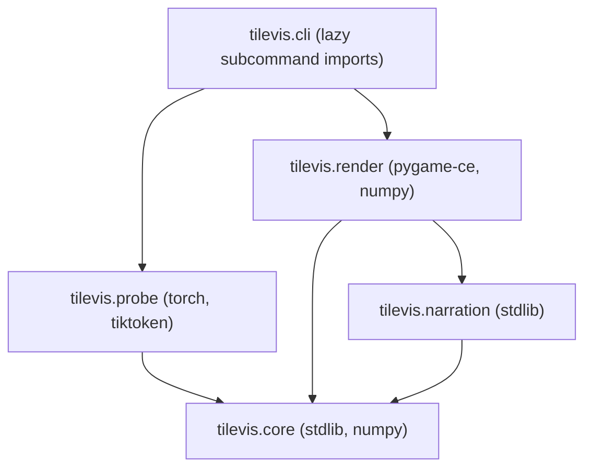

# LLM Tile Visualizer (`tilevis`) — Technical Documentation

This document is the technical reference and contributor guide for **`tilevis`**, a modular Python application that visualizes a GPT-style Large Language Model's forward pass as an interactive, step-by-step colored-tile animation.

> **Related documents**
> - [`agents.md`](agents.md) — Authoritative implementation rules and 8-phase build plan for AI coding agents.
> - [`changelog.md`](changelog.md) — Phase-by-phase engineering log of features, test summaries and architectural decisions.
> - [`architecture_proposal.md`](architecture_proposal.md) — Initial conceptual proposal (superseded by this document and `agents.md` where details differ).

---

## 1. Overview and Design Philosophy

`tilevis` was designed for a live classroom presentation to students with little or no LLM background, sitting cleanly on top of the existing project code in `ch07/01_main-chapter-code/previous_chapters.py` **without modifying any file in `ch07/`**.

Three core architectural choices govern the system:

1. **Record once, play anywhere (`probe` → `Trace` → `render`).**
   Model execution (`probe`, powered by PyTorch) and interactive visualization (`render`, powered by `pygame-ce`) are completely decoupled. `probe` runs a multi-token generation loop and writes a self-contained `*.trace.npz` file. `render` reads only that Trace file. As a result:
   - Stepping forward **and backward** one full layer per keypress is an $O(1)$ index change—no mid-forward-pass thread pausing in PyTorch.
   - The lecture-hall Windows PC needs **only `numpy` and `pygame-ce`** (or a standalone PyInstaller folder)—no PyTorch, CUDA, or multi-gigabyte model checkpoints on stage.
2. **Dynamic adaptation to any teammate's model.**
   Instead of hard-coding layer counts or dimensions, `probe` infers configuration parameters (`n_layers`, `emb_dim`, `vocab_size`, `context_length`, `qkv_bias`) directly from checkpoint tensor shapes, unwraps LoRA/DataParallel state dicts, auto-detects `n_heads` by verifying attention math against captured activations, and maps module names via swappable `ArchitectureAdapter`s.
3. **Progressive disclosure for non-expert audiences.**
   Traces record full layer-by-layer detail, while the renderer's **playlist filter** lets the presenter choose between `STORY` (collapsed transformer blocks), `STANDARD` (expanded first block, summarized remaining blocks) and `DEEP` (per-head inspection), plus an on-demand **Nerd Mode** (`N`) overlay for exact shapes, paths and numerical statistics.

---

## 2. Environment Setup and Dependencies

### 2.1 Python & OS Support

- **Python:** `3.11` – `3.13` (`3.12` recommended for development). Python 3.11+ provides `tomllib` in the standard library and modern typing features (`StrEnum`, `Self`, generics).
- **Operating Systems:** Windows 10/11 (primary presentation target via single-monitor screenshare), macOS and Linux.

### 2.2 Installation Modes

Once Phase 1 scaffolding (`pyproject.toml`) is in place, install `tilevis` in a virtual environment according to your role:

```bash
# 1. Playback-only setup (e.g., Windows lecture-hall PC — no PyTorch installed)
python -m venv .venv
# Windows: .venv\Scripts\activate   |   macOS/Linux: source .venv/bin/activate
pip install -e .

# 2. Full contributor & model-recording setup
pip install -e ".[record,dev]"

# 3. Optional standalone Windows player packaging
pip install -e ".[build]"
```

### 2.3 Dependency Matrix

| Package | Version | Scope | Used By | Purpose & Compatibility Notes |
|---|---|---|---|---|
| `numpy` | `>=1.26` | Base runtime | `core`, `probe`, `render` | Trace array storage, stats, vectorized colormap LUTs. *(Note: if using `torch 2.3.x`, pin `numpy<2`; `torch >=2.4` supports `numpy 2.x`.)* |
| `pygame-ce` | `>=2.5` | Base runtime | `render` | Window management, 2D tile surface rendering, fonts, mouse/keyboard input. Import name is still `import pygame`. |
| `torch` | `>=2.3` | `[record]` | `probe` | Loads `.pth` checkpoints, runs inference and attaches forward hooks. Never imported by `core`, `narration` or `render`. |
| `tiktoken` | `>=0.7` | `[record]` | `probe` | GPT-2 BPE tokenization matching `previous_chapters.py`. |
| `matplotlib` | `>=3.8` | `[record]` (indirect) | `ch07` model code | Imported at top level by `previous_chapters.py`; `tilevis` itself never uses `matplotlib`. |
| `pytest`, `pytest-cov`, `pytest-timeout` | latest | `[dev]` | `tests` | Unit, headless UI, integration and performance test suites. |
| `hypothesis` | latest | `[dev]` | `tests` | Property-based testing for serialization, reducers, colormaps and playlist navigation. |
| `ruff` | latest | `[dev]` | repo-wide | Linting and code formatting (`line-length = 100`). |
| `mypy` | latest | `[dev]` | repo-wide | Static type checking (`--strict` for `core`, `narration`, `render`). |
| `pyinstaller` | `>=6.0` | `[build]` | packaging | Optional single-folder Windows player executable (built natively on Windows). |

> **Important (`pygame` vs `pygame-ce`):** Never install `pygame` and `pygame-ce` in the same environment—both write to the `pygame` import namespace and conflict. Run `tilevis check` to verify your environment.

---

## 3. Project Structure and Module Dependencies

### 3.1 Repository Layout

```text
llm_tile_visualizer/
├── ch07/                        # Read-only upstream LLM codebase (NEVER modify)
│   └── 01_main-chapter-code/
│       ├── previous_chapters.py # GPTModel, MultiHeadAttention, TransformerBlock, ...
│       ├── gpt_instruction_finetuning.py
│       └── exercise_experiments.py
├── profiles/                    # Per-model TOML profiles (checkpoint path, overrides, LoRA)
│   ├── tiny_random.toml
│   └── example_team_model.toml
├── presenter/
│   └── default.toml             # Window mode, theme, detail level, keybindings
├── traces/
│   └── samples/                 # Committed small .trace.npz files for torch-free testing/demos
├── scripts/
│   ├── play_demo.bat            # Windows lecture-hall launcher
│   └── play_demo.sh             # macOS/Linux launcher
├── src/tilevis/
│   ├── cli.py                   # `tilevis` CLI (`record`, `play`, `inspect`, `check`, `demo`)
│   ├── logging_setup.py
│   ├── core/                    # Shared immutable Trace contract, serialization, registries
│   ├── probe/                   # PyTorch model loader, adapters, hooks, reducers, recorder
│   ├── narration/               # Audience-friendly captions & locale TOML catalogs
│   ├── render/                  # pygame-ce app, playlist/player, scenes, widgets, themes
│   └── assets/fonts/            # Bundled OFL fonts (Noto Sans) — zero OS font reliance
└── tests/
    ├── compat_matrix.py         # Shared matrix of model shapes & checkpoint styles
    ├── fixtures/                # Synthetic torch-free Trace builder & tiny GPT fixtures
    ├── core/  probe/  narration/  render/  integration/
    └── test_import_boundaries.py
```

### 3.2 Strict Package Dependency Rules

To guarantee that playback remains lightweight and immune to deep-learning environment issues, package imports obey a strict directed acyclic graph enforced by `tests/test_import_boundaries.py`:



| Package | Allowed Internal Imports | Allowed Third-Party Imports | Explicitly Forbidden |
|---|---|---|---|
| `tilevis.core` | *(none)* | `numpy` | `torch`, `pygame`, `tiktoken`, `matplotlib` |
| `tilevis.narration` | `tilevis.core` | *(none — stdlib only)* | `torch`, `pygame`, `numpy` |
| `tilevis.probe` | `tilevis.core` | `torch`, `tiktoken`, `numpy`, user model file | `pygame`, `tilevis.render`, `tilevis.narration` |
| `tilevis.render` | `tilevis.core`, `tilevis.narration` | `pygame` (`pygame-ce`), `numpy` | `torch`, `tiktoken`, `tilevis.probe`, `matplotlib` |
| `tilevis.cli` | Any (imported lazily inside subcommand handlers) | stdlib `argparse` | Top-level eager imports of `probe` or `render` |

---

## 4. Trace Data Contract (`schema_version = 1`)

The `Trace` hierarchy in `src/tilevis/core/trace.py` is the **sole interface** between `probe` and `render`. All dataclasses are `@dataclass(frozen=True, slots=True)` and mark underlying NumPy arrays read-only (`write=False`).

### 4.1 Object Hierarchy

- **`Trace`**: top-level container holding `schema_version`, `tilevis_version`, `created_at` (ISO-8601), `model: ModelSpecInfo`, `prompt: str`, `settings` and `passes: tuple[PassRecord, ...]`.
- **`PassRecord`**: one autoregressive forward pass (generating one token). Contains `index`, `input_ids`, `input_tokens` (human-readable strings such as `·effort` or `↵`), `text_before`, `steps: tuple[Step, ...]` and `prediction: Prediction | None`.
- **`Step`**: one logical layer/operation step (e.g., `"p0.b0.att.scores"`). Contains:
  - `kind`: *how to visualize* (`PROMPT`, `TOKENIZE`, `EMBEDDING`, `LAYERNORM`, `LINEAR`, `QKV_PROJECTION`, `ATTENTION_PATTERN`, `ATTENTION_MIX`, `ACTIVATION`, `RESIDUAL_ADD`, `BLOCK_SUMMARY`, `LOGITS`, `NEXT_TOKEN`, `GENERIC`).
  - `semantic`: *what it means* (`embed`, `block.norm1`, `block.att.qkv`, `block.ff.expand`, `next_token`, etc.) used by `CaptionProvider`.
  - `stage`: `INPUT` | `BLOCK` | `OUTPUT`.
  - `block_index`: `0 .. n_layers - 1` or `None`.
  - `detail_level`: `1` (`STORY`), `2` (`STANDARD`), or `3` (`DEEP`).
  - `tensors`: `tuple[TensorSnapshot, ...]` tagged by `role` (`input`, `weight`, `output`, `shortcut`, `update`, `attn_weights`, `probs`, etc.).
  - `fidelity`: `Fidelity(status, max_abs_err, note)` recording whether recomputed/hooked values matched ground-truth model tensors (`exact`, `approximate`, `unverified`, `failed`).
- **`TensorSnapshot`**: reduced `float32` array (`1D`, `2D`, or `3D` `(head, q, k)` for attention patterns), paired with `axes: tuple[AxisInfo, ...]`, `full_shape`, `reduction` name and `stats: TensorStats` (`min`, `max`, `mean`, `std`, `abs_max`, `abs_p99` computed **before** reduction).

### 4.2 Matrix Orientation & Consistent Reduction

- **Activations** are always stored as `(token, feature)`.
- **Linear weights** are transposed from PyTorch's `(out_features, in_features)` to **`(in_features, out_features)`** by `probe/weights.py`. Thus every matrix multiplication visually reads left-to-right:
  $$\text{input } (T \times D_{\text{in}}) \;\times\; \text{weight } (D_{\text{in}} \times D_{\text{out}}) \;=\; \text{output } (T \times D_{\text{out}})$$
- **Consistent `IndexPlan`:** when dimensions exceed display limits (default `max_features = 64`, `max_tokens = 24`), `probe/reduce.py` computes a deterministic `indices` array once per axis family (`model_dim`, `ff_dim`, `token`, `head`). Tile column `j` in `norm1` therefore represents the **exact same neuron index** as tile column `j` in `resid1`, and hover tooltips map back to the true original index via `AxisInfo.indices[j]`.

### 4.3 On-Disk Format (`*.trace.npz`)

- Standard compressed NumPy ZIP archive (`np.savez_compressed`), always loaded with **`allow_pickle=False`** (safe to open untrusted teammate files).
- Entry `__manifest__` is a `uint8` byte array encoding UTF-8 JSON for the entire `Trace` tree, with each `np.ndarray` replaced by a string pointer `"@a0"`, `"@a1"`, etc.
- Entries `a0`, `a1`, … store the raw `float32` / `int64` arrays.
- **Schema evolution:** breaking changes to `Trace` must increment `TRACE_SCHEMA_VERSION`, add a pure dictionary transformer in `core/serialization.py:MIGRATIONS`, update `validate_trace()`, and log a `**BREAKING**` note in `changelog.md`. Unknown `StepKind` or `Semantic` strings from newer minor versions never crash—they fall back to `GenericScene` and generic captions.

### 4.4 Trace Invariant Validation Rules

The `validate_trace(trace, strict=False)` validator in `src/tilevis/core/validation.py` enforces structural and numerical invariants:

1. **Schema & Model Consistency:**
   - `schema_version` must equal `TRACE_SCHEMA_VERSION` (currently `1`).
   - `model.n_layers >= 1`, `model.emb_dim >= 1`, `model.vocab_size >= 1`, `model.n_params >= 0`.
   - `block_index` on block steps must be within `[0, model.n_layers)`.
2. **Numeric Finiteness & Dimensions:**
   - Every tensor snapshot array must be purely finite: zero NaNs or Infinities allowed (`np.all(np.isfinite(data))`).
   - Snapshot data dimensionality must match axis count: `data.ndim == len(axes)`.
   - Each axis index count must match tensor dimensions: `len(ax.indices) == data.shape[d]`.
3. **Axis Invariants & Monotonicity:**
   - `AxisInfo.indices` must be strictly increasing with values strictly within `[0, full_size)`.
   - `token` axes must have string `labels` whose count matches the displayed token length.
4. **Step Identity & Pipeline Invariants:**
   - Step IDs must be non-empty and unique across the entire trace.
   - Detail levels must be valid (`STORY = 1`, `STANDARD = 2`, `DEEP = 3`).
   - Each forward pass may contain at most one `NEXT_TOKEN` step, and if present, it must be the final (terminal) step of that pass.
5. **Prediction Distribution:**
   - Candidate array lengths (`candidate_ids`, `candidate_tokens`, `candidate_probs`) must be identical.
   - Candidate probabilities must lie in `[0.0, 1.0]` and be sorted in strictly descending order.

---

## 5. Probe: Dynamic Model Loading and Hooking

Teammates may train checkpoints with varying `n_layers`, `emb_dim`, `n_heads`, `context_length`, `qkv_bias`, prompt templates, or LoRA wrappers (`LinearWithLoRA` from `exercise_experiments.py`).

### 5.1 Model Profiles (`profiles/*.toml`)

To onboard any model, create a small TOML file (paths resolve relative to the TOML file itself):

```toml
[profile]
name = "Teammate B — 6-Layer Alpaca SFT + LoRA"

[model]
code = "../ch07/01_main-chapter-code/previous_chapters.py"
class = "GPTModel"
checkpoint = "../checkpoints/team_b_sft_lora.pth"
seed = 42

[model.config]
# Optional: anything omitted is inferred automatically from checkpoint shapes.
n_heads = 8

[model.lora]
alpha = 16   # Required only if checkpoint holds unmerged .lora.A / .lora.B tensors

[text]
tokenizer = "gpt2"
template = "alpaca"   # "raw" | "alpaca"

[adapter]
name = "auto"         # "auto" | "gpt_scratch" | "generic"
```

Run `tilevis inspect --profile profiles/my_model.toml` to verify config inference, parameter counts and adapter bindings before recording.

### 5.2 Config Inference & Checkpoint Normalization

When loading a `.pth` file, `probe/loading/` automatically:
1. Unwraps nested checkpoint dicts (`model_state_dict`, `state_dict`, `model`) and strips `module.` / `_orig_mod.` prefixes.
2. Detects `.lora.A` and `.lora.B` tensors and folds them into standard linear weights (`W_eff = W + alpha * (A @ B).T`).
3. Infers `vocab_size` & `emb_dim` from `tok_emb.weight`, `context_length` from `pos_emb.weight`, `n_layers` from `trf_blocks.{i}.*` keys, and `qkv_bias` from `W_query.bias` presence.
4. Detects `n_heads` automatically during the first forward pass (if omitted in the profile) by testing divisors of `emb_dim` against captured `out_proj` inputs.

### 5.3 Capturing Operations Inside `forward()`

PyTorch module hooks only observe `nn.Module` inputs and outputs, whereas causal masking, scaled dot-product softmax and residual additions (`x + shortcut`) occur as inline tensor ops inside `previous_chapters.py`:
- **Attention internals (`probe/builders/attention.py`):** captures `norm1` output, `W_query`/`W_key`/`W_value` outputs, and `out_proj` input (`ctx_true`), recomputes per-head scores, causal mask and softmax weights under `torch.inference_mode()`, and verifies `max_abs_err` against `ctx_true`. If a custom model alters attention math such that verification fails, `tilevis` gracefully emits a `GENERIC` black-box step instead of crashing.
- **Residual connections (`probe/builders/residual.py`):** captures block pre-hook inputs (`shortcut`) and sublayer outputs (`update`), verifying `shortcut + update` against the subsequent normalization input or block output.
- **Read-only guarantee:** `HookManager` detaches and clones tensors to CPU `float32`, restores `training` mode, and removes all hook handles inside a `finally` block. Logits with and without `TraceRecorder` are verified bit-for-bit identical.

---

## 6. Renderer, Playlist and Presentation UX

### 6.1 Playlist Filtering (`render/playlist.py`)

A 24-layer model with 14 internal sub-steps per block produces >340 steps per generated token—too many to click through one by one unless desired. `build_playlist(trace, presenter_settings)` builds a flat list of `StepRef`s tailored to the talk:
- **`detail_level = 1` (`STORY`):** shows Prompt → Tokenize → Embed → one `BLOCK_SUMMARY` step per layer → Next-Token Prediction.
- **`detail_level = 2` (`STANDARD`, default) + `detail_blocks = "first"`:** expands Block 1 into full layer-by-layer steps (`norm1`, `QKV`, `attention`, `mix`, `out_proj`, `resid1`, `norm2`, `ff.expand`, `GELU`, `ff.contract`, `resid2`), summarizes Blocks `2..N` into one step each, and expands final output & prediction. Later passes default to `later_pass_level = 1` so multi-word generation stays brisk.
- **`D` key at runtime:** cycles detail levels on the fly while `StepPlayer` re-anchors to the current pass and block.

### 6.2 Color Scaling & Visual Legibility

- **Outlier-resistant scaling:** trained GPT-2 layers exhibit extreme activation outliers in a few channels. `shared_step` and `per_tensor` normalizers scale colors symmetrically to `±stats.abs_p99` rather than `abs_max`, keeping tile contrast vivid while hover tooltips still report exact unclipped values.
- **Colorblind-safe palettes:** default signed colormap is `diverging_blue_orange` (blue = negative, neutral = zero, orange = positive); probabilities and attention weights use `sequential_purple`. Both `dark` and `light` themes enforce text contrast $\ge 4.5:1$.
- **Windows screenshare engineering:** `render/platform.py` enables Windows Per-Monitor High-DPI awareness before SDL initialization so text and tiles stay razor-sharp at 125%/150% display scaling, and `window.mode` defaults to `borderless` (`NOFRAME` at desktop size) to avoid exclusive-fullscreen black screens and `Alt+Tab` glitches in screenshare software.

---

## 7. CLI Reference

```bash
# Inspect a profile or raw .pth checkpoint (inferred config, adapter, parameter count)
tilevis inspect --profile profiles/example_team_model.toml
tilevis inspect --checkpoint path/to/model.pth

# Record a forward/generation trace to disk (requires .[record])
tilevis record \
  --profile profiles/example_team_model.toml \
  --prompt "Every effort moves you" \
  --new-tokens 3 \
  --strategy greedy \
  -o traces/team_model.trace.npz

# Play back a recorded trace (requires ONLY base install: numpy + pygame-ce)
tilevis play traces/team_model.trace.npz --window borderless --theme dark

# Preflight check on the presentation machine (fonts, display, trace integrity)
tilevis check traces/team_model.trace.npz

# Instant zero-config demo using a tiny seeded random model (requires .[record])
tilevis demo --prompt "Hello world"
```

---

## 8. Contributor Guide: Extending `tilevis`

`tilevis` uses decorator-based registries (`tilevis.core.registry.Registry`) rather than `if/elif` chains so features can be added in isolated modules.

### 8.1 Supporting a Custom Model Architecture

1. **Same architecture, different checkpoint or hyper-parameters:** no code changes needed—create a `profiles/<name>.toml` file and test with `tilevis inspect`.
2. **Renamed attributes on a GPT-style model:** map attribute paths under `[adapter.roles]` in the profile TOML.
3. **Substantially new block structure (e.g., Llama-style RMSNorm + SwiGLU):**
   - Create `src/tilevis/probe/adapters/<arch>.py` implementing `ArchitectureAdapter` (`matches()` and `describe()`) and decorate with `@ADAPTERS.register("<arch>")`.
   - If the model introduces a new parameterized layer class, register a weight extractor in `src/tilevis/probe/weights.py` via `@WEIGHT_EXTRACTORS.register(...)` (remembering to return linear-like weights as `(in, out)`).
   - Add a representative tiny configuration to `tests/compat_matrix.py` so every phase's compatibility suite covers it automatically.

### 8.2 Adding or Customizing a Scene

1. Create `src/tilevis/render/scenes/<my_scene>.py` implementing the `Scene` protocol (`enter`, `update`, `draw`, `finish`, `is_animating`, `hit_test`, `handle_command`).
2. Keep scenes **stateless across steps**—compute layout from `stage: pygame.Rect` and `ctx.scale: UiScale`, and build `TileGrid` surfaces in `enter()`.
3. Register the class in `src/tilevis/render/scenes/registry.py` with `@SCENES.register(StepKind.<KIND>)`.
4. Add contract tests (animation termination, `finish()` equivalence, headless multi-resolution rendering) in `tests/render/`.

### 8.3 Adding Themes, Colormaps, or Caption Languages

- **Theme:** register a `Theme` instance in `src/tilevis/render/themes/builtin.py` under `@THEMES.register("my_theme")` and verify WCAG $\ge 4.5:1$ text contrast in `tests/render/test_themes.py`.
- **Colormap:** provide control points or a `(256, 3)` `uint8` LUT in `src/tilevis/render/colormap.py` via `@COLORMAPS.register("my_map")`.
- **Caption locale:** copy `src/tilevis/narration/locales/en.toml` to `<lang>.toml`, translate `title`, `body` and `nerd` templates (preserving `{placeholders}`), bundle an OFL font supporting that script in `src/tilevis/assets/fonts/`, and set `locale = "<lang>"` in `presenter/default.toml`.

---

## 9. Testing, Quality Standards and Workflow

### 9.1 Running Checks Locally

```bash
# Fast default test suite (unit + headless render + integration, excluding slow/manual)
pytest -m "not slow and not manual"

# Full phase-gate suite (includes GPT-2-small-shaped compatibility and perf budgets)
pytest -m "not manual" --cov=tilevis

# Verify strict module import boundaries
pytest tests/test_import_boundaries.py

# Linting, formatting, and static type checking
ruff check src tests
ruff format --check src tests
mypy --strict src/tilevis/core src/tilevis/narration src/tilevis/render
mypy src/tilevis/probe
```

### 9.2 Contribution Rules Summary

1. **Never edit anything under `ch07/`.** Always verify `git status ch07/` is clean before committing.
2. **Cross-platform file safety:** always use `pathlib.Path` and pass `encoding="utf-8"` on every text read/write so Korean Windows (`cp949` default locale) never fails.
3. **Headless testability:** all renderer features must work through `App.tick(dt, events)` under `SDL_VIDEODRIVER=dummy` without a real monitor or wall-clock `sleep`.
4. **Update `changelog.md`:** log every phase milestone, user-facing decision, new dependency, or schema change following the format in `agents.md` §10.
